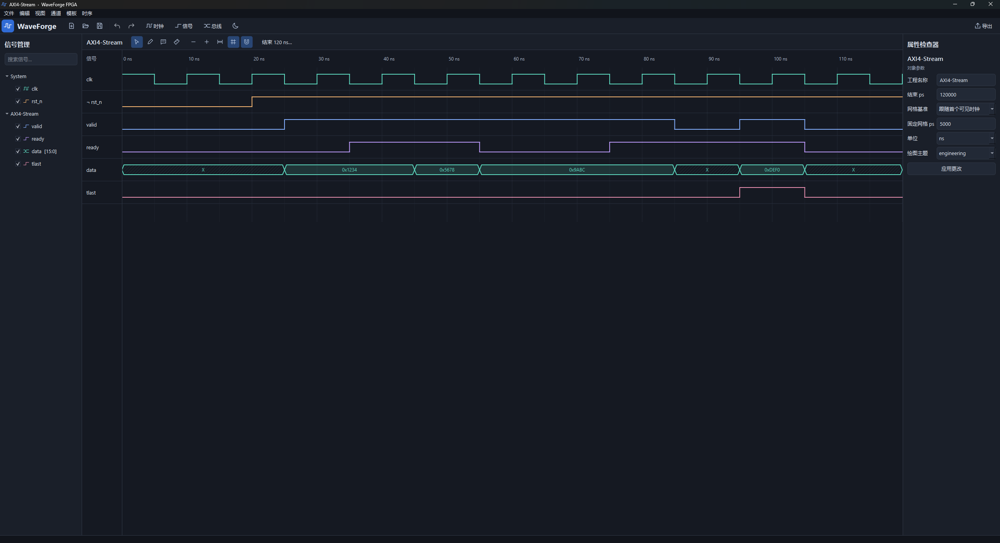
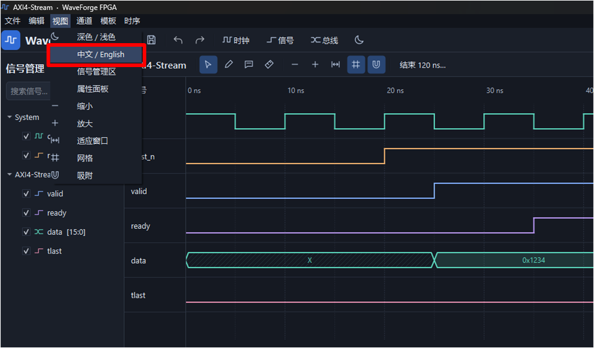

# WaveForge FPGA

[中文](README.md) | **English**



A digital timing diagram editor with a dark theme and a Chinese interface by default. On first launch, you can edit the AXI4-Stream example or create an empty project with **File → New**. Switch the interface language through **View → 中文 / English**.

## Running on Windows

Download `WaveForge-FPGA-win64.zip` from the repository, extract the complete archive, and run `WaveForge-FPGA.exe`. Keep its accompanying files and directories together. You can also drag a `.wfg` project onto the executable to open it.

How do I switch this software to English? 


Just click the button inside the red box!
## Running from source

Python 3.11 or later is required. Install the dependencies and run `main.py` from the project directory.

```powershell
python -m venv .venv
.\.venv\Scripts\python -m pip install -r requirements.txt
.\.venv\Scripts\python main.py
```

On Linux, create the environment with `python3 -m venv .venv` and use `.venv/bin/python` for installation and launch. Qt requires the appropriate platform libraries and fonts for your desktop environment.

## Drawing and editing

| Operation | Instructions |
| --- | --- |
| Add channels | Use **Clock**, **Signal**, or **Bus** on the toolbar. A 100 MHz clock has a period of 10,000 ps. Frequency input is quantized to the nearest integer picosecond period. |
| Edit properties | Select a channel in the tree or canvas, change its properties, and click **Apply changes**. Clock frequency and period describe the base clock. The divider multiplies its output period, and inversion applies to the output. |
| Change logic states | Double-click a signal in Select mode or click in Draw mode. States include 0, 1, X, Z, weak high H, weak low L, contention C, and glitch G. |
| Edit buses | Double-click a segment to change its value. Right-click at a new time and choose **Insert transition** to split a segment. Values accept `0x` and `0b` prefixes. Unprefixed values use the channel's radix. Enter `INVALID` for an invalid segment. |
| Move edges | Drag a transition or bus boundary. Adjacent transitions constrain its movement. Drag a clock to change its phase. The magnet button toggles snapping to the grid and nearby visible edges. |
| Set precise times | Enter a segment's start time in ps in the inspector. The first segment starts at zero. **Timing → Project settings** controls the end time, units, grid interval, and plot style. |
| Use a clock-based grid | By default, the grid follows the first visible clock's period, frequency, divider, and phase. Even picosecond periods have half-cycle subdivisions. Odd periods use full cycles. Choose **Fixed interval** under **Grid source** in Project settings to specify a fixed grid in ps. The fixed interval is also used when no clock is visible. Older projects default to clock-following mode. |
| Extend the timeline | Click **End 120 ns…** above the canvas; the displayed value reflects the current project. For example, enter 500 and select ns to extend the timeline to 500 ns. The view fits the new range automatically. Clocks continue repeating, while signals and buses retain their final states. You can insert transitions in the extended region. This operation supports undo, saving, and reopening. |
| Edit multiple channels | Use Ctrl to select multiple channels, Ctrl+C/V to copy and paste, and Delete to remove the selection. A selected edge takes priority when deleting transitions. Locked channels are retained. Copying all channels referenced by an annotation also copies that annotation. |
| Organize signals | Search by name and use checkboxes to control visibility. Drag rows in the signal tree or drag names vertically in the canvas name column to reorder channels. A blue insertion line indicates the drop position in the name column. Ctrl-selected channels can move together. Dropping across groups assigns the destination group. Locked channels retain their positions. Use **Edit → Group** to assign a group and collapse groups to hide their waveforms. Order is saved and supports undo. |
| Align or delay edges | Select channels or a transition and open **Timing → Align or shift edges**. Choose a reference clock, rising or falling edges, and an offset, or shift by cycles or ps. Operations that would overlap, cross, or move transitions out of range are rolled back. |
| Navigate | Scroll the wheel to zoom, Shift+wheel to scroll horizontally, Alt+wheel to scroll vertically, and use the middle mouse button to pan. Shift+left-drag selects and zooms into a time range. Drag panel and name-column dividers to resize them. |
| Measure intervals | Select Measure mode and click two positions to place A and B. The status bar shows their time difference. Clicking an existing cursor selects it, and dragging moves that cursor. You can drag the A/B ruler handles in any mode. After both cursors are placed, clicking an empty position moves the closer cursor. Overlapping handles occupy separate vertical lanes so they can be dragged apart. Esc cancels a drag. The context menu can move A or B explicitly, and the Timing menu can clear the cursors. |
| Add annotations | In Annotate mode, click the start and end positions and choose Setup, Hold, Clock-to-Q, an arrow, text, or another annotation type. With snapping enabled, clicking near an edge binds the endpoint to that edge. |
| Edit annotations | Select an object under **Annotations** in the tree to edit its font, color, arrow style, stroke width, and endpoints. Alt+drag an endpoint in Select mode to rebind it. Entering a new absolute endpoint time removes its edge binding. |
| Add clock guides and time breaks | Select a clock and enable rising-edge, falling-edge, or cycle guides in its inspector. Set its guide color and apply the changes. Multiple clocks can display guides simultaneously, with distinct default colors and independent periods and phases. **Timing → Add cycle guides for a clock…** lets you choose a specific clock. Right-clicking a clock waveform targets that clock directly. Repeated addition keeps a single set of guides. Time breaks compress selected intervals visually while measurements and stored data retain their actual times. |
| Delete one guide | Right-click near a guide and select **Delete guide · clock name · time**. Guides from different clocks at the same time can be deleted separately. Right-click the corresponding clock to restore its deleted guides. Deletions follow the associated edges and support undo, saving, reopening, and export. Individual guides on locked clocks cannot be deleted. |
| Delete a clock's guides | Choose **Timing → Delete all cycle guides for a clock…** and select the target clock. Right-clicking a clock waveform targets that clock directly. This clears its enabled rising-edge, falling-edge, and cycle guides as a group. The operation supports undo, saving, and reopening. Adding guides again restores the complete cycle guide set. |
| Choose colors | Select a clock, single-bit signal, or bus and click the swatch beside **Color** in the inspector. Choose a preset or a custom RGB/HSV color, confirm, and click **Apply changes**. The swatch previews your selection. Hexadecimal input is also supported. Guide and annotation colors use the same palette controls. Color changes support undo, saving, and export. |
| Undo and redo | Use Ctrl+Z and Ctrl+Y. One completed drag creates one undo step. |
| Change theme or language | Use **View** to switch between dark/light themes or Chinese/English. Project settings provides `engineering`, `paper`, and `datasheet` plot styles. |

### Examples and templates

`examples/AXI4-Stream.wfg` includes a 100 MHz clock, an active-low reset, valid, ready, a 16-bit data bus, and tlast. The first valid transfer is sampled on the rising edge at 40 ns, after which the bus changes from `0x1234` to `0x5678`. The example also contains Setup and Hold intervals bound to specific edges.

The **Templates** menu provides synchronous reset, asynchronous reset, clock enable, FIFO, RAM, SPI, UART, AXI4-Stream, AXI4-Lite, and Valid/Ready examples. These generate editable channels. User templates are stored as `.wfg` files and can be loaded as new projects. You can also save selected channels as a template and insert them into the current project with **Insert channels from template**.

### Saving and recovery

The `.wfg` format is UTF-8 JSON, currently at version 1. Transitions and annotation endpoints are linked by independent IDs. Deleting a transition fixes its referenced annotation endpoints at their previous times. Deleting a channel removes its associated annotations.

Saving uses a temporary file in the destination directory and an atomic replacement. Modified projects write recovery data every 12 seconds. On the next launch, the application can recover a session that ended unexpectedly. User templates and recovery files reside in the Qt application data directory. Set `WAVEFORGE_DATA_DIR` to choose a different location.

### Import and export

- Import digital VCD or wide-format CSV from the File menu. Enter start and end times in ps to crop the input. The last state before the crop start becomes the initial state, and imported time starts at zero. Channels with a consistent, representable period and duty cycle across all samples can become parameterized clocks.
- Name the first CSV column `time_ns`, `time_ps`, `time_us`, or another supported time unit. `time` defaults to ns. Use `data[15:0]` or `data[16]` to declare a 16-bit bus. Unprefixed CSV numbers are interpreted as decimal.

```csv
time_ns,rst_n,valid,ready,data[15:0]
0,0,0,0,X
10,1,1,0,0x1234
20,1,1,1,0x1234
30,1,1,1,0x5678
```

- Press Ctrl+E to export PNG, SVG, or PDF. **File → Copy waveform image** copies an image to the system clipboard. Export options include width, background, time range, font, grid, stroke width, and margins. Image height follows the visible channels and annotation rows. SVG and PDF use Qt vector drawing.

## Testing and packaging

```powershell
.\.venv\Scripts\python -m pip install -r requirements-dev.txt
.\.venv\Scripts\python -m pytest -q
.\build.ps1
```

Tests drive the main window through Qt's offscreen platform. They cover creating channels from an empty project, mouse interactions, bindings and undo, project round trips, export formats, import cropping, copying and grouping, recovery files, and a 128-channel view. Windows releases use PyInstaller's directory mode. Run the build script on Windows.

## Source layout

- `app/core` manages integer picosecond times, parameterized clocks, ordered segments, project validation, and edge bindings.
- `app/graphics` manages time-axis mapping, row-level QGraphicsItems, annotation geometry, visible-region rendering, and mouse gestures.
- `app/commands` manages QUndoStack commands. Edge drags record the target and its old and new times.
- `app/ui` manages the Qt window, signal tree, inspector, themes, dialogs, and project operations.
- `app/services` manages atomic storage, examples, and protocol templates. `app/importers` and `app/exporters` handle input and output.
- `tests` contains model, import/export, and GUI integration tests.
