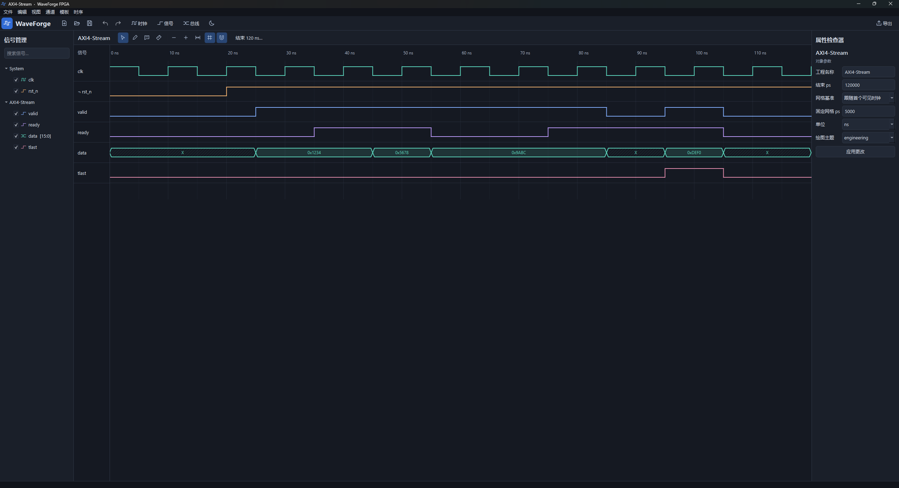

# WaveForge FPGA

**中文** | [English](README.en.md)


数字时序图编辑器。界面默认使用中文深色主题。首次启动后可直接编辑 AXI4-Stream 示例，也可以用 **文件 → 新建** 创建空白工程。

## Windows 运行

在仓库中下载 `WaveForge-FPGA-win64.zip`。解压后运行也`WaveForge-FPGA.exe`,也可将 `.wfg` 拖到 EXE 图标上打开。


## 从源码运行

需要 Python 3.11 或以上版本,运行main.py即可

## 绘制和编辑

| 操作 | 方法 |
| --- | --- |
| 添加通道 | 顶部「时钟」「信号」「总线」。100 MHz 对应 10,000 ps。频率输入按最接近的整数 ps 周期量化。 |
| 编辑属性 | 在信号树或画布选择通道，修改右侧参数后点「应用更改」。时钟的 MHz 和周期对应基础时钟，分频会乘到输出周期上。反相作用于输出。 |
| 更改信号状态 | 选择模式双击信号，或用绘制模式单击；可选 0、1、X、Z、弱高 H、弱低 L、竞争 C、毛刺 G。 |
| 编辑总线 | 双击已有区段改值。在新时间点右键「插入跳变」来拆分区段。支持 0x、0b 前缀，未加前缀时使用通道进制。无效区段可输入 INVALID。 |
| 移动边沿 | 拖动跳变线或总线边界。相邻跳变限制移动范围。拖动时钟可改变相位；按工具栏磁铁切换网格和邻近可见边沿吸附。 |
| 精确时间 | 属性面板可直接输入区段起点 ps。首段从 0 开始。菜单「时序 → 工程设置」可改结束时间、显示单位、网格间隔和绘图主题。 |
| 周期网格 | 默认跟随首个可见时钟，修改周期、频率、分频或相位会同步更新主网格、细分网格和吸附间隔。偶数 ps 周期提供半周期细分，奇数 ps 周期按整周期划分。可在「时序 → 工程设置 → 网格基准」选择「固定时间间隔」，再设置固定网格 ps。没有可见时钟时使用固定间隔。旧版工程默认采用时钟跟随模式。 |
| 延长波形 | 点击画布工具栏的「结束 120 ns…」（数值随工程变化），输入例如 500 并选择 ns，即可延长到 500 ns。也可从「时序」菜单打开此对话框。应用后自动适应整个时间范围；时钟继续重复，信号和总线保持最后状态，可在新增时间区域继续插入跳变。支持撤销、保存和重新打开。 |
| 批量编辑 | Ctrl 多选，Ctrl+C/V 复制粘贴通道，Delete 删除。已选边沿优先删除跳变。锁定通道保留。一起复制绑定标注的全部通道会同时复制标注。 |
| 管理信号 | 按名称搜索；勾选框控制可见性；在左侧信号树拖动行，或在画布左边的信号名称列上下拖动，可调整顺序。名称列显示蓝色插入线；Ctrl 多选可整体拖动。跨组放置时加入目标组，锁定的信号保持位置。「编辑 → 分组」指定组名，折叠组可收起所属波形。排序支持撤销及工程保存。 |
| 对齐或延迟 | 选择通道或单个跳变，打开「时序 → 对齐或平移边沿」，选择参考时钟、上升或下降沿及偏移量，也可按周期或 ps 平移。会造成边沿重叠、交叉或越界的操作整体回退。 |
| 浏览 | 滚轮缩放，Shift+滚轮水平滚动，Alt+滚轮纵向滚动，中键平移，Shift+左键框选时间范围并放大。拖动面板及信号名称列分隔条调整宽度。 |
| 测量 | 选择尺子工具后依次点击两处放置 A、B，底栏显示时间差。点击已有浮标会选中它，拖动只移动该浮标；也可在任意模式下拖动标尺上的 A/B 标签。两个浮标就位后，点击空白位置会移动较近的一个。两者重合时标签上下错开，可分别拖开；Esc 取消拖动。右键菜单可指定移动 A 或 B，时序菜单可清除游标。 |
| 时序标注 | 选择标注工具，依次点起点与终点，然后选择 Setup、Hold、Clock-to-Q、箭头、文本等类型。启用吸附并点在边沿附近可建立绑定。 |
| 修改标注 | 在信号树的「时序标注」中选择对象，右侧可编辑字体、颜色、箭头、线宽及端点。选择模式下 Alt+拖动端点可重新绑定。输入新的绝对端点时间会解除该端点绑定。 |
| 时钟参考线和断点 | 选择某个时钟，在属性面板分别勾选上升沿、下降沿、周期参考线，并设置参考线颜色（如 #4F8CFF），然后应用。多个时钟可同时显示各自的参考线，自动分配不同默认颜色，随各自周期和相位更新。在「时序」菜单选择「添加指定时钟的周期参考线」，再从列表明确指定目标时钟。右键某条时钟波形可直接为该时钟添加周期参考线。重复添加会保留一组参考线。也可添加压缩显示的时间段。原始时间、测量值和工程数据使用真实时间。 |
| 删除单条参考线 | 在需要删除的参考线附近右键，选择「删除参考线 · 时钟名 · 时间」。重叠的多个时钟参考线可分别删除。右键对应时钟波形可「恢复此时钟已删除的参考线」。删除记录跟随边沿，支持撤销、保存、重开及导出；锁定时钟的参考线不可删除。 |
| 删除指定时钟的周期参考线 | 在「时序」菜单选择「删除指定时钟的所有周期参考线」，再选择目标时钟。右键时钟波形时，该操作直接作用于该时钟。所选时钟此前启用的上升沿、下降沿和周期参考线一并清除。支持撤销、保存、重新打开；再次添加可恢复完整周期参考线。 |
| 调色盘 | 选择任意时钟、单比特信号或总线，点击属性面板「颜色」右侧的色块打开调色盘。选择预设色或自定义 RGB/HSV 颜色，确认后点击「应用更改」。色块预览随选择更新，也可直接输入十六进制颜色。参考线和标注颜色同样支持调色盘；颜色修改支持撤销、保存和导出。 |
| 撤销与重做 | Ctrl+Z / Ctrl+Y。一次拖动对应一个撤销步骤。 |
| 主题及语言 | 「视图」切换深浅色或中文 / English。「工程设置」提供 engineering、paper、datasheet 三种绘图风格。 |

### 示例和模板

`examples/AXI4-Stream.wfg` 包含 100 MHz 时钟、低有效复位、valid、ready、16 位 data 和 tlast。首次有效传输在 40 ns 上升沿被采样，随后总线从 0x1234 更新为 0x5678。示例还包含绑定到具体边沿的 Setup 和 Hold 间隔。

「模板」菜单提供同步复位、异步复位、时钟使能、FIFO、RAM、SPI、UART、AXI4-Stream、AXI4-Lite 和 Valid/Ready。模板生成普通可编辑通道。用户模板保存为 .wfg，可加载为独立新工程。也可只保存所选通道，再用「插入模板通道」将其插入当前工程。

### 保存与恢复

.wfg 是 UTF-8 JSON，当前格式版本为 1。跳变和标注端点以独立 ID 关联。删除跳变会将引用该边沿的端点固定在原时间；删除通道会清理关联标注。保存使用同目录临时文件和原子替换。修改后每 12 秒写入恢复文件，下次启动可恢复异常结束会话。用户模板与恢复文件位于 Qt 应用数据目录，可用环境变量 `WAVEFORGE_DATA_DIR` 设置其位置。

### 导入与导出

- 文件菜单可导入数字 VCD 和宽表 CSV，在导入对话框输入以 ps 为单位的起止时间即可裁剪。裁剪起点之前的最后状态成为新工程的初值，导入时间从零开始。等周期、占空比可表示且与全部样本一致的通道可转换为参数时钟。
- CSV 首列用 `time_ns`、`time_ps`、`time_us` 等标示单位。`time` 默认为 ns。总线列用 `data[15:0]` 或 `data[16]` 声明 16 位。无前缀的 CSV 数字按十进制读取。

```csv
time_ns,rst_n,valid,ready,data[15:0]
0,0,0,0,X
10,1,1,0,0x1234
20,1,1,1,0x1234
30,1,1,1,0x5678
```

- Ctrl+E 导出 PNG、SVG 或 PDF。「文件 → 复制波形图片」写入系统剪贴板。导出可以设置宽度、背景、起止时间、字体、网格、线宽和边距。图高按可见通道和标注行数计算。SVG 与 PDF 使用 Qt 矢量绘制。

## 验证与重新打包

```powershell
.\.venv\Scripts\python -m pip install -r requirements-dev.txt
.\.venv\Scripts\python -m pytest -q
.\build.ps1
```

测试用 Qt 的 offscreen 平台驱动主窗口，覆盖从空白工程添加时钟及信号、真实鼠标事件、绑定与撤销、工程往返、各格式导出、导入裁剪、复制与分组、自动恢复文件和 128 通道视图。Windows 打包使用 PyInstaller 的目录模式；在 Windows 上执行构建脚本。

## 源码结构

- `app/core` 管理整数 ps 时间、参数时钟、有序分段、工程校验与边沿绑定。
- `app/graphics` 管理时轴映射、行级 QGraphicsItem、标注几何、可见区域采样与鼠标手势。
- `app/commands` 管理 QUndoStack 命令，边沿拖动只记录目标和前后时间。
- `app/ui` 管理 Qt 窗口、信号树、检查器、主题、对话框及工程操作。
- `app/services` 管理原子文件存储、示例和协议模板。`app/importers` 与 `app/exporters` 分别处理输入和输出。
- `tests` 包含模型、导入导出和 GUI 集成验证。

